<!--
Imágenes de referentes (carpeta de Google Drive):
https://drive.google.com/drive/folders/1F8CgfenQyUOwHTlOWpZnli5U9iEemZzt
Copiadas a imagenes/referentes/ el 10 de noviembre de 2026; arremangala21 y nicolae24 añadidas el 14 de noviembre de 2026.
malhumor22, poetrycube, maresca25 y benn26 descargadas desde el Google Doc (no están en Drive).
Textos: https://docs.google.com/document/d/1IanvUpH2ZdVfKeIRI0DPBFfOE0LND5OIgGLkUMoFvns
-->

## 01 — Body / Environment

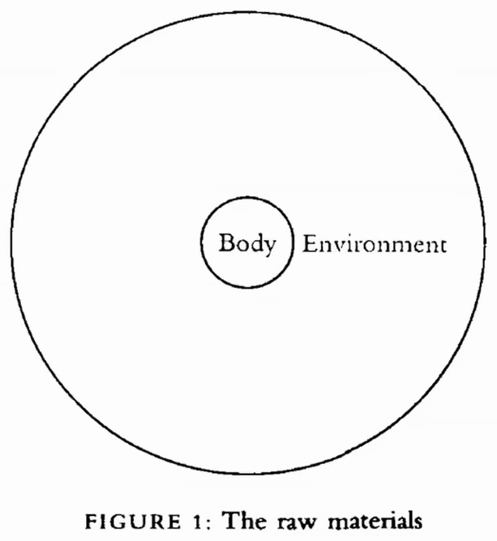

*Body / Environment* ("Figure 1: The raw materials"), autor desconocido (s. f.)

Bloque de Are.na: [are.na/block/7694147](https://www.are.na/block/7694147).

## 02 — Mapa de percepción de riesgos

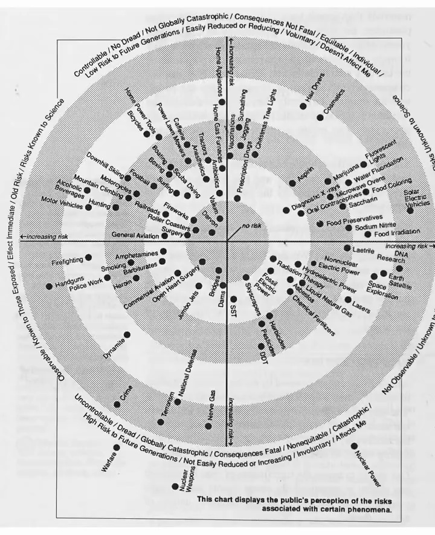

*Information Anxiety*, Richard Saul Wurman (1989)

Nueva York: Doubleday.

## 03 — Mandala del teatro orientado al contexto

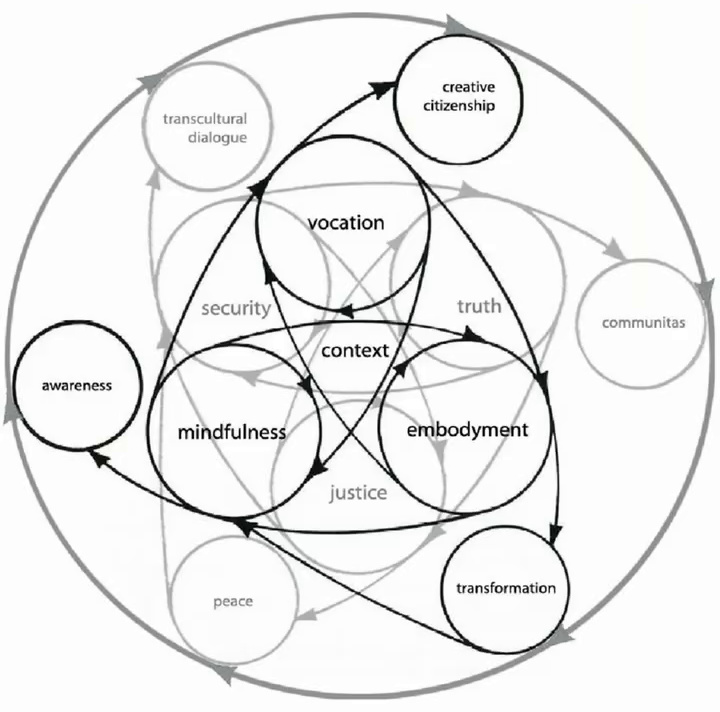

*Mandala of context oriented theatre*, autor desconocido (s. f.)

Bloque de Are.na: [are.na/block/3052676](https://www.are.na/block/3052676).

## 04 — Laberinto de la catedral de Lucca

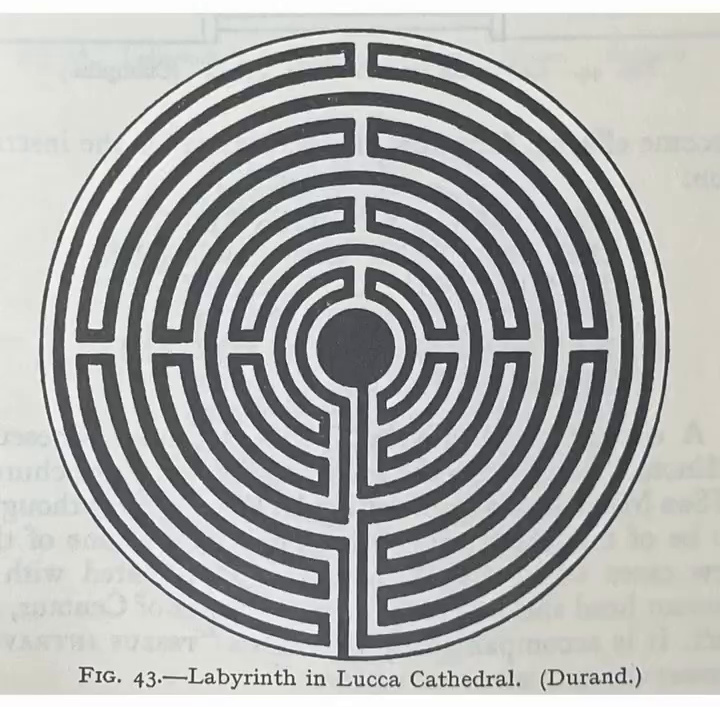

*Mazes and Labyrinths: A General Account of Their History and Developments*, W. H. Matthews (1922)

Londres: Longmans, Green and Co. Fig. 43, "Labyrinth in Lucca Cathedral (Durand)".

## 05 — Actividades de computación digital y cibernética

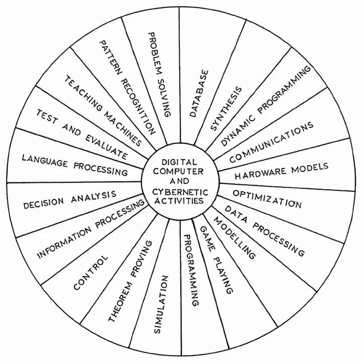

*Digital Computer and Cybernetic Activities*, autor desconocido (s. f.)

Bloque de Are.na: [are.na/block/1965168](https://www.are.na/block/1965168).

## 06 — Rueda de códigos inversos

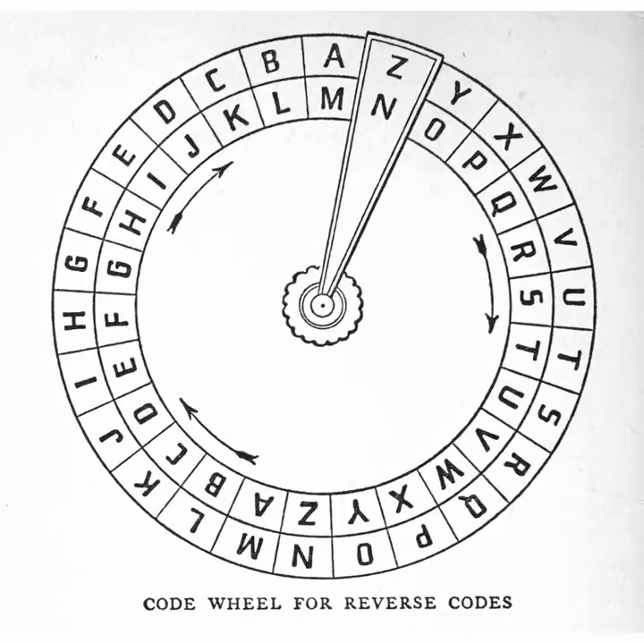

*Codes and Secret Writing*, Herbert S. Zim (1948)

Nueva York: William Morrow.

## 07 — Disposición de líneas de transmisión de un CDAA

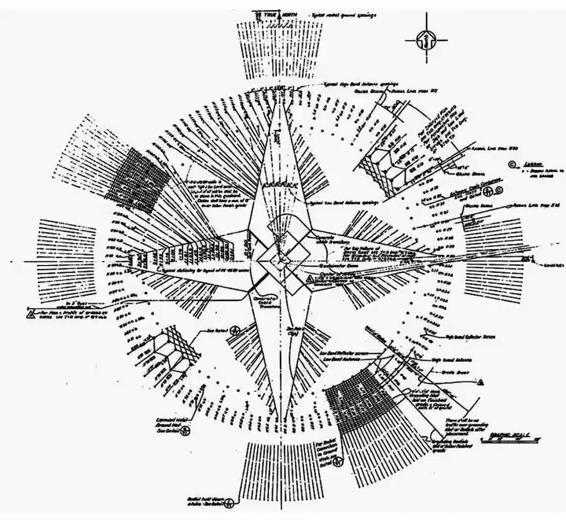

*CDAA Transmission Line Layout*, autor desconocido (s. f.)

Bloque de Are.na: [are.na/block/6920431](https://www.are.na/block/6920431).

## 08 — Figura 7: Purposing

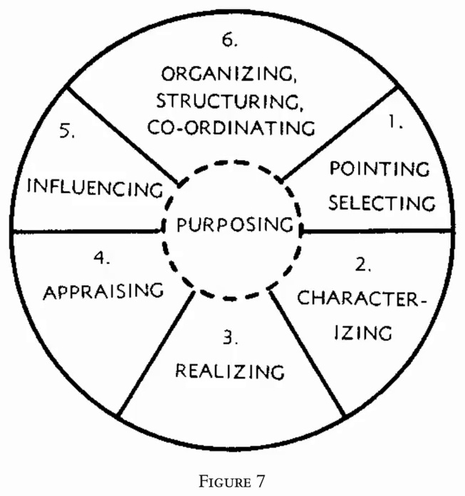

*Cybernetics / Kybernetik: The Macy-Conferences 1946–1953*, Claus Pias (ed.) (2003–2004)

Zúrich y Berlín: diaphanes. Figura 7, "Purposing".

## 09 — Rueda de la vida (reinos)

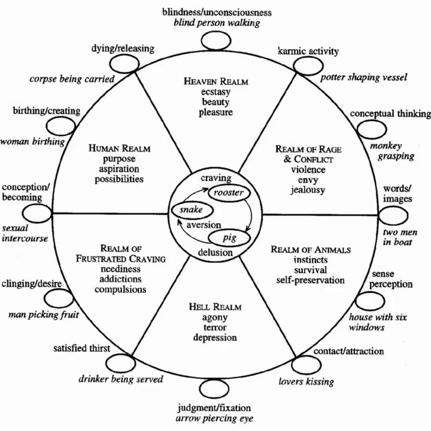

*Rueda de la vida* (bhavacakra), autor desconocido (s. f.)

Bloque de Are.na: [are.na/block/652219](https://www.are.na/block/652219).

## 10 — Gusanos y peces

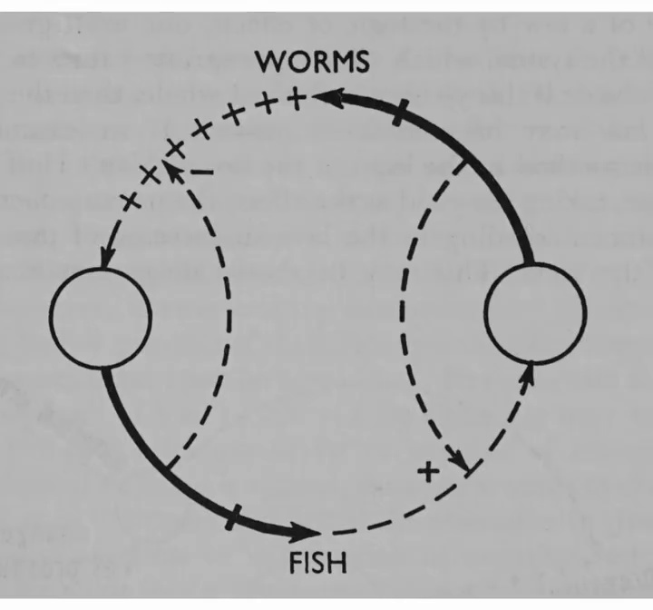

*Thinking by Machine: A Study of Cybernetics*, Pierre de Latil (1956)

Boston: Houghton Mifflin. Original en francés: *La pensée artificielle* (1953), París: Gallimard.

## 11 — Inanición en un anillo full-duplex

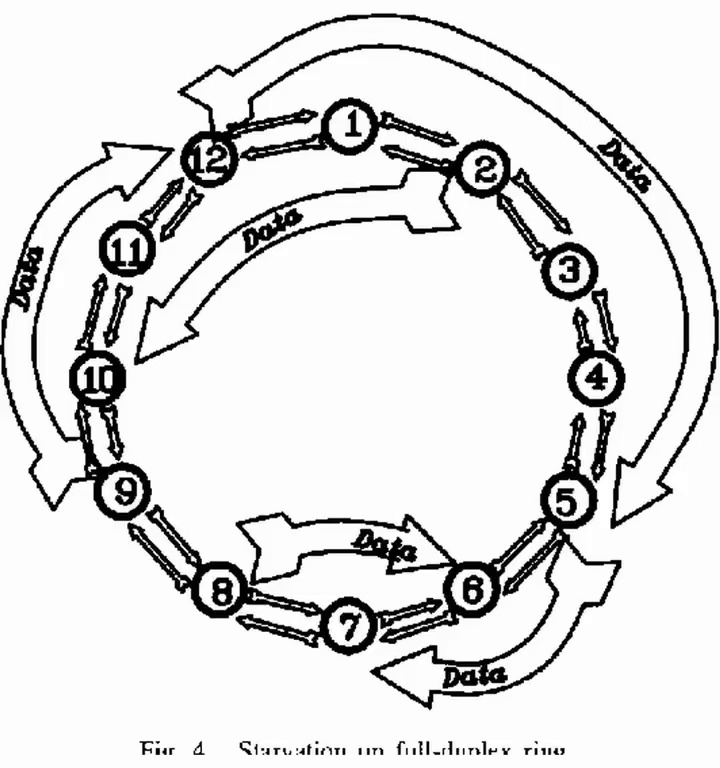

*Starvation on full-duplex ring* (Fig. 4), autor desconocido (s. f.)

Bloque de Are.na: [are.na/block/5120612](https://www.are.na/block/5120612).

## 12 — Círculos de generative somatics

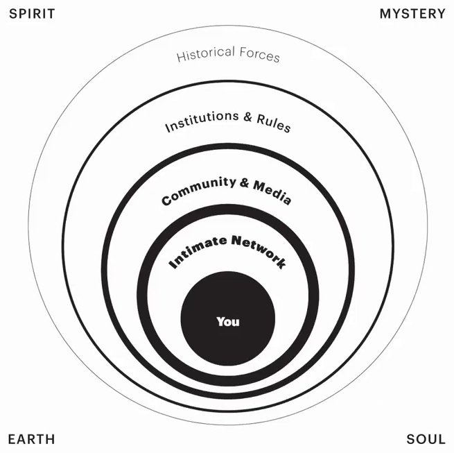

*generative somatics*, Alta Starr (s. f.)

Bloque de Are.na: [are.na/block/7381174](https://www.are.na/block/7381174).

## 13 — Teitelbaum: biofeedback dream

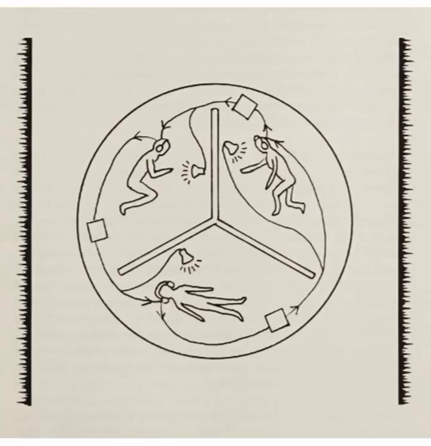

*Biofeedback dream*, Richard Teitelbaum (s. f.)

Bloque de Are.na: [are.na/block/36738359](https://www.are.na/block/36738359).

## 14 — Feedback, de Skip Sweeney

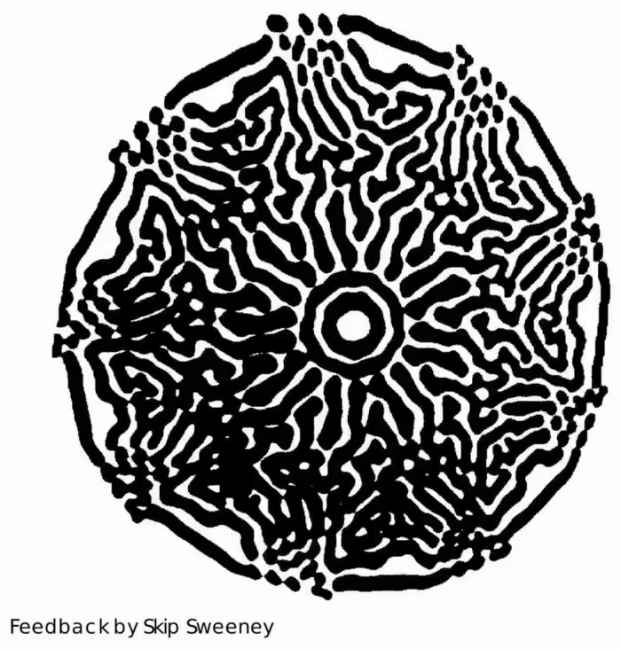

*Eigenwelt der Apparate-Welt: Pioneers of Electronic Art*, David Dunn (ed.) (1992)

Linz: Ars Electronica. Exposición curada por Woody y Steina Vasulka. Imagen: "Feedback", Skip Sweeney.

## 15 — La teoría de la información y otros campos

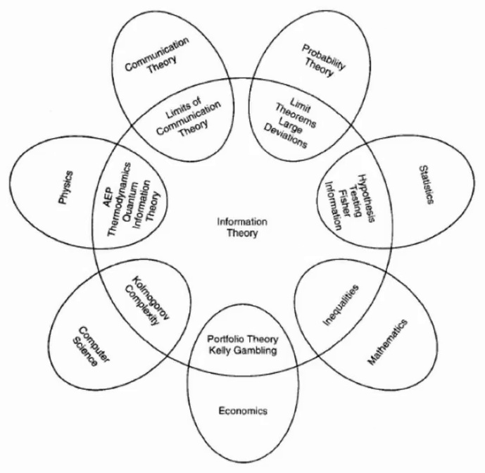

*Elements of Information Theory*, Thomas M. Cover y Joy A. Thomas (1991)

Nueva York: Wiley. Bloque de Are.na: [are.na/block/3209681](https://www.are.na/block/3209681).

## 16 — Ecuante ptolemaico

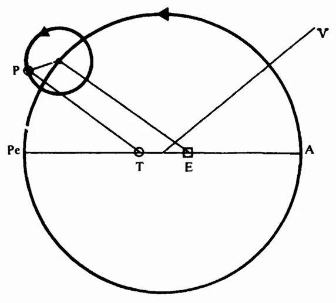

*Against Method*, Paul Feyerabend (1975)

Londres: New Left Books.

## Árbol del arte moderno

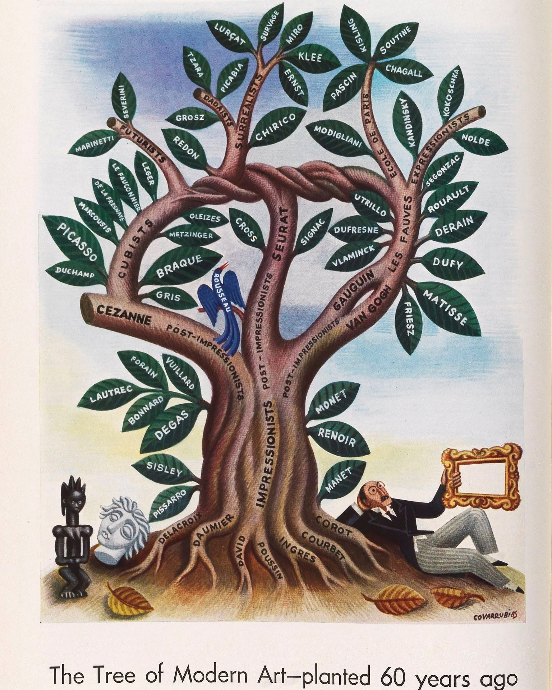

*The Tree of Modern Art—Planted 60 Years Ago*, Miguel Covarrubias (1933)

Covarrubias, M. (1933, mayo). The tree of modern art—planted 60 years ago [Ilustración]. *Vanity Fair, 40*(3), 36–37. [moma.org](https://www.moma.org/momaorg/shared/pdfs/docs/archives/InventingAbstraction_GLowry_359_363.pdf)

## Cubismo y arte abstracto

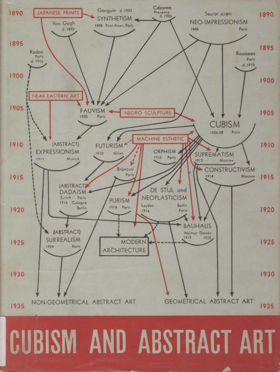

*Cubism and Abstract Art*, Alfred H. Barr Jr. (1936)

Barr, A. H., Jr. (1936). *Cubism and abstract art* [Catálogo de exposición; diagrama en la sobrecubierta]. The Museum of Modern Art. [moma.org](https://www.moma.org/calendar/exhibitions/2748)

## Boceto para una historia de Fluxus

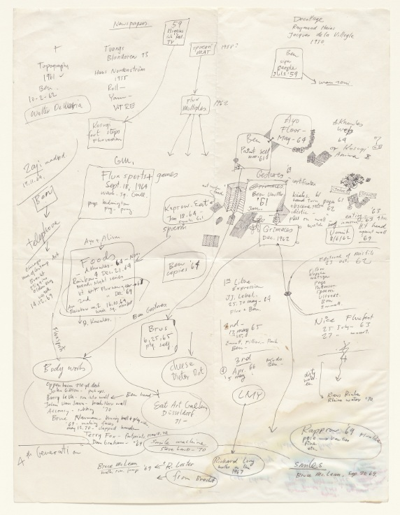

*Rough Sketch for Chart*, George Maciunas (s. f.)

Maciunas, G. (s. f.). *Rough sketch for chart* [Boceto manuscrito]. The Gilbert and Lila Silverman Fluxus Collection Archives, The Museum of Modern Art. [moma.org](https://www.moma.org/interactives/exhibitions/2013/charting_fluxus/)

## Diagrama de las artes expandidas

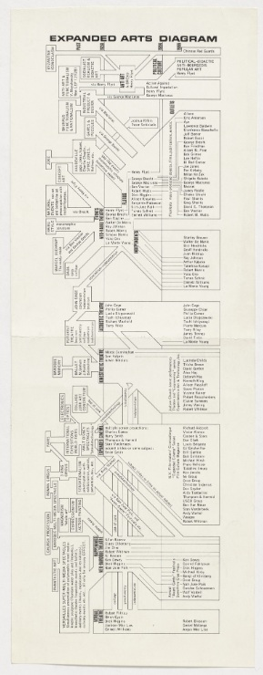

*Expanded Arts Diagram*, George Maciunas (1966)

Maciunas, G. (1966). *Expanded arts diagram* [Litografía ófset]. The Museum of Modern Art. [moma.org](https://www.moma.org/collection/works/128225)

## El arte como movimiento

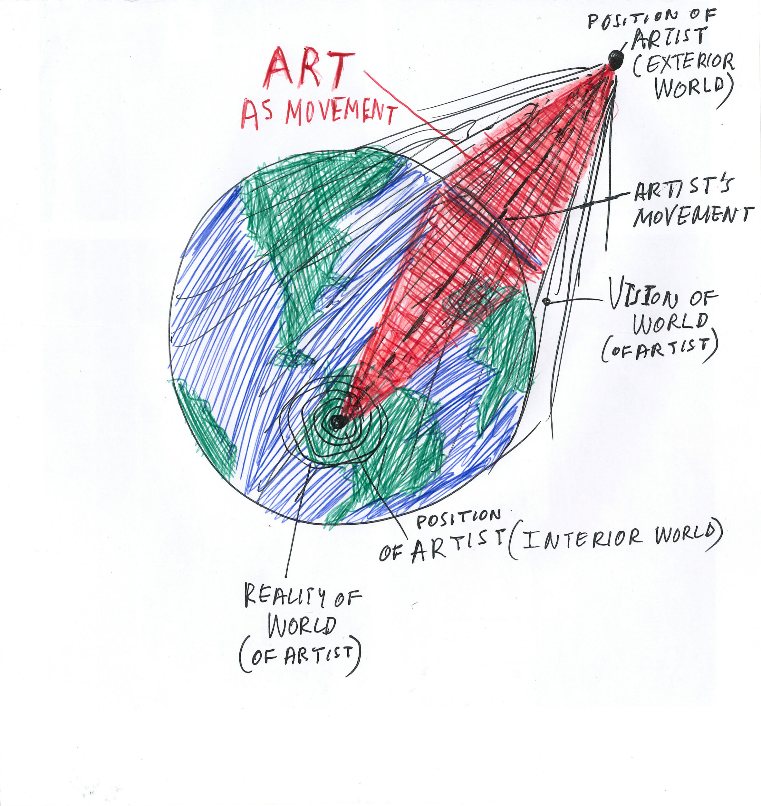

*Schema: Art as Movement*, Thomas Hirschhorn (2025)

Hirschhorn, T. (2025). *Schema: Art as movement* [Diagrama]. [thomashirschhorn.com](https://www.thomashirschhorn.com/maps-schemas/)

## Árbol de la vida

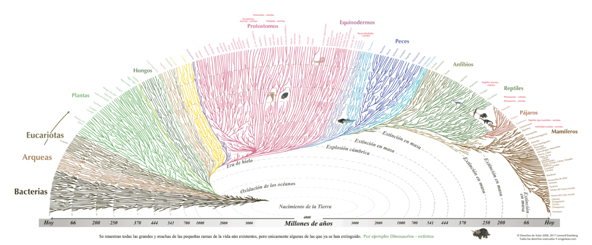

*Árbol de la vida de Evogeneao*, Leonard Eisenberg (2017; versión de un diseño de 2008)

Eisenberg, L. (2017). *Árbol de la vida* [Diagrama, versión en español]. Evogeneao. [evogeneao.com](https://www.evogeneao.com/es/explore/tree-of-life-translations)

## Estudios sobre flores, musgos y líquenes

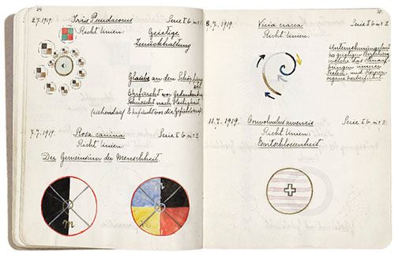

*From A Work on Flowers, Mosses and Lichen*, Hilma af Klint (1919)

af Klint, H. (1919). *From A Work on Flowers, Mosses and Lichen* [Páginas de cuaderno]. Moderna Museet. [modernamuseet.se](https://www.modernamuseet.se/en/stockholm/exhibitions/hilma-af-klint-2013/symbols/)

## Cinco tradiciones de la historia del arte

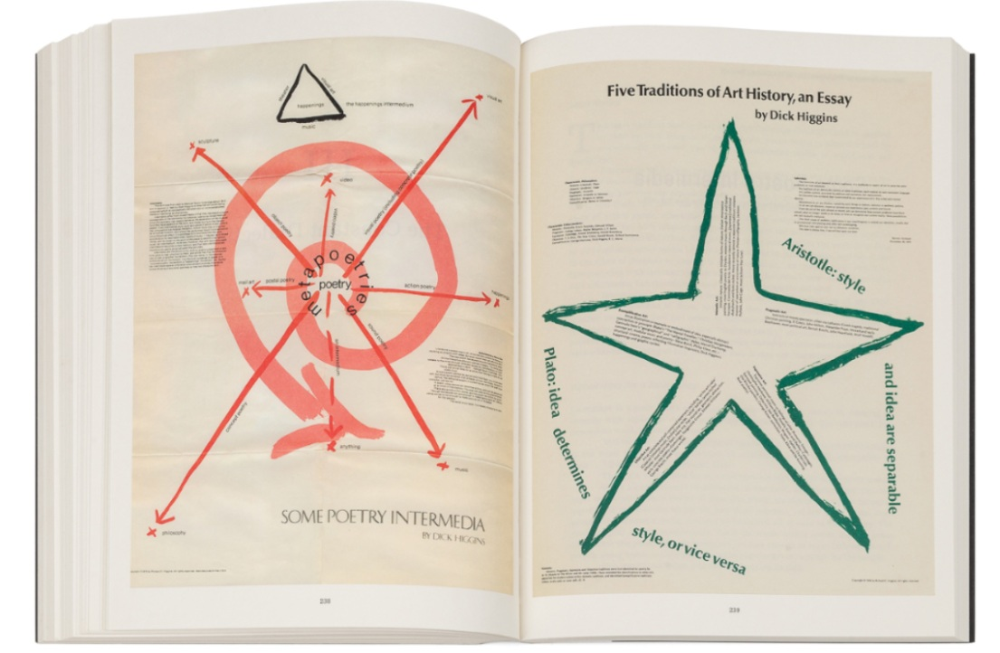

*Five Traditions of Art History, an Essay*, Dick Higgins (1976)

Higgins, D. (1976). *Five traditions of art history, an essay* [Diagrama e impresión ófset]. Walker Art Center. [walkerart.org](https://www.walkerart.org/collections/artwork/five-traditions-of-art-history-an-essay-by-dick-higgins/)

## Diagrama de intermedia

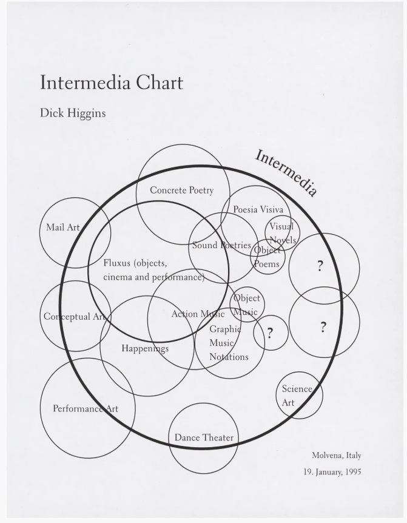

*Intermedia Chart*, Dick Higgins (1995)

Higgins, D. (1995). *Intermedia chart* [Diagrama]. Fondazione Bonotto. [fondazionebonotto.org](https://www.fondazionebonotto.org/en/collection/fluxus/higginsdick/983.html)

## Escuchar

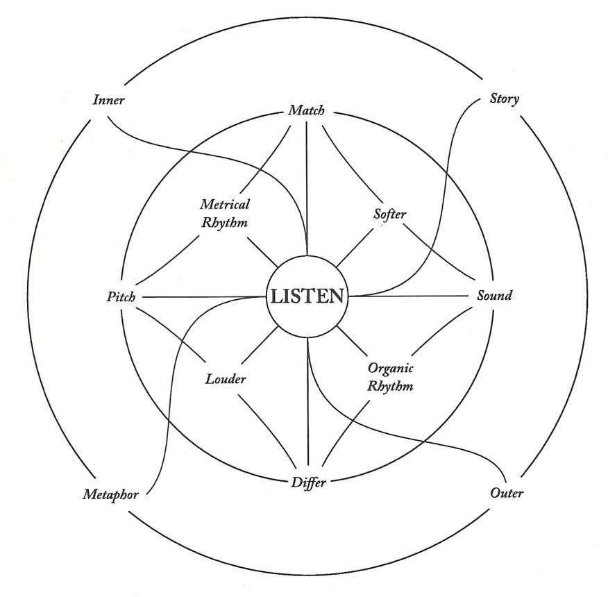

*Wind Horse Mandala*, Pauline Oliveros (1994)

Oliveros, P. (with Pertl, B.). (2013). *Anthology of text scores* (S. Golter & L. Hall, Eds.). Deep Listening Publications.

## Unión de mapas de trayectorias teatrales

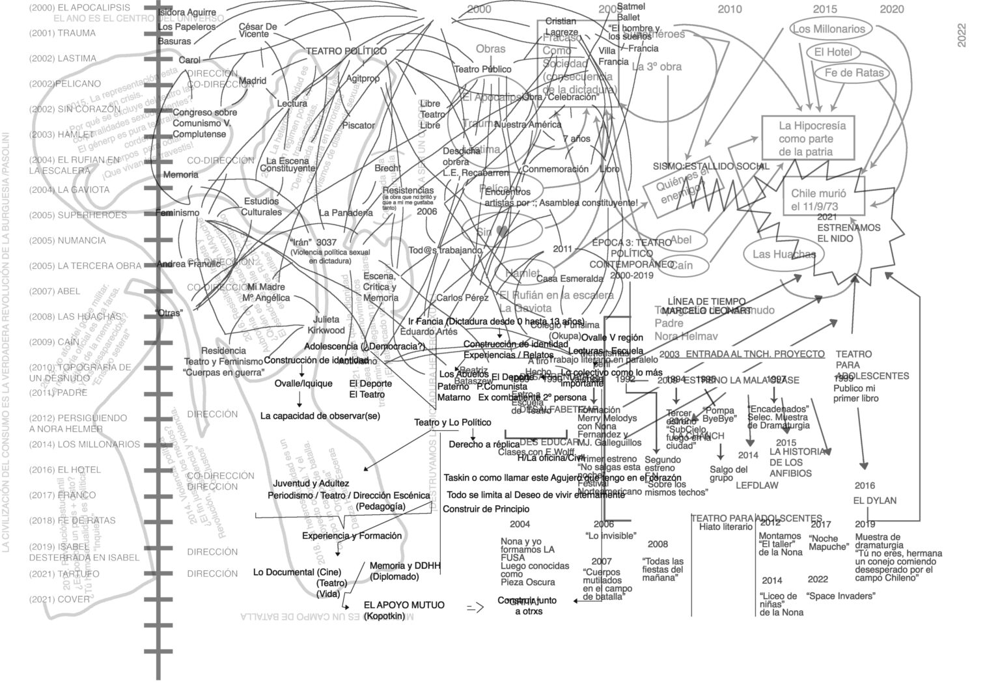

*Imagen unión de mapas*, Camila Bardehle (2022)

Bardehle, C. (2022, septiembre). *Imagen unión de mapas* [Composición gráfica]. ARDE, Archivos de Arte. [proyectoarde.org](https://proyectoarde.org/items/show/6863)

La composición reúne dibujos de directores teatrales sobre sus trayectorias.

## Mapa de la trayectoria de Ernesto Orellana

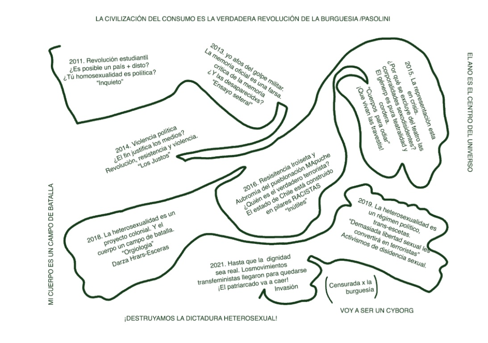

*Mapa de Ernesto Orellana*, Ernesto Orellana (s. f.)

Orellana, E. (s. f.). *Mapa de Ernesto Orellana* [Dibujo]. Colección Escenas de lo político: cartografía del teatro político chileno contemporáneo, ARDE, Archivos de Arte. [proyectoarde.org](https://proyectoarde.org/mapas-y-diagramas-para-cartografiar-teatro/)

## Caminos del estudio de la naturaleza

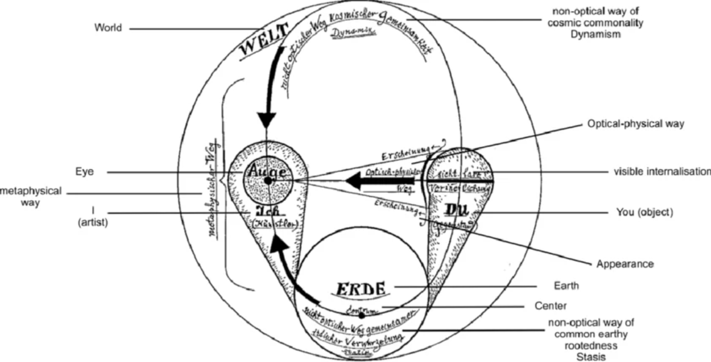

*Wege des Naturstudiums* (Caminos del estudio de la naturaleza), Paul Klee (1923)

Klee, P. (1923). Wege des Naturstudiums. En *Staatliches Bauhaus in Weimar 1919–1923*. Bauhausverlag.

## Red de Industrias Carlos Cardoen

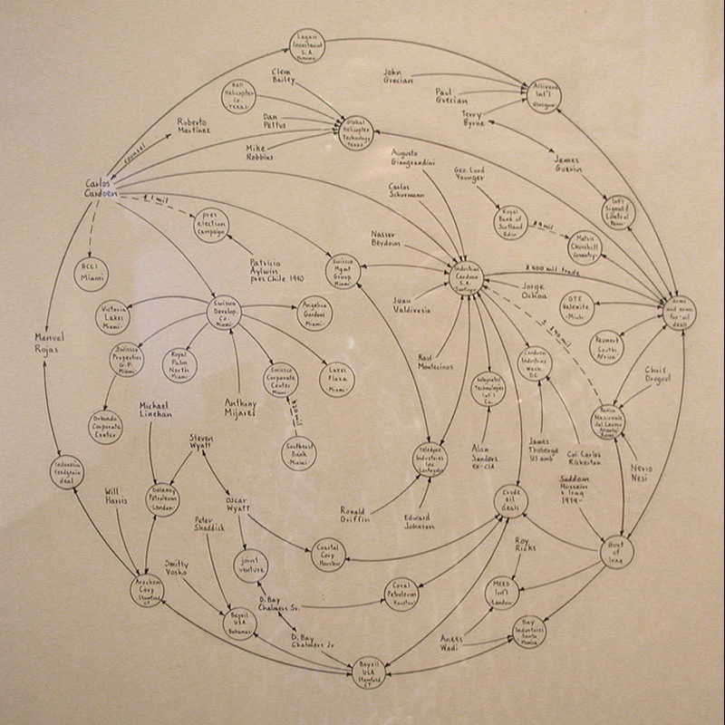

*Industrias Carlos Cardoen of Santiago, Chile, 1982–90, 2nd Version*, Mark Lombardi (2000)

Lombardi, M. (2000). *Industrias Carlos Cardoen of Santiago, Chile, 1982–90 (2nd version)* [Dibujo a lápiz]. En *Mark Lombardi* [Material de exposición]. University Art Museum, University at Albany. [universityartmuseum.org](https://archive.universityartmuseum.org/images/PDF/20010124.pdf)

## Differently

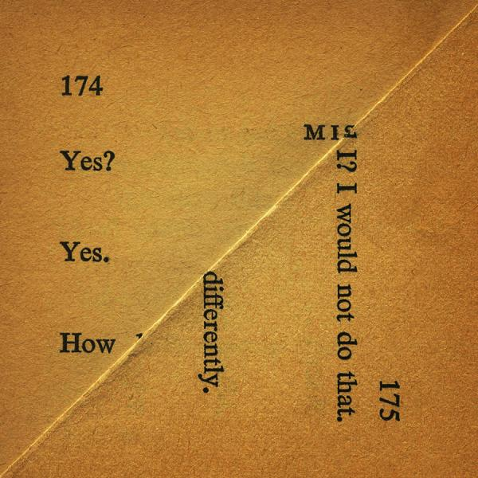

*Differently*, de la serie *Dog Ear*, Erica Baum (2009)

Baum, E. (2009). *Differently* [Impresión de inyección de tinta, serie Dog Ear]. George Eastman Museum. [eastman.org](https://www.eastman.org/erica-baum-bite-ribbon-paper-show)

## Autorretrato

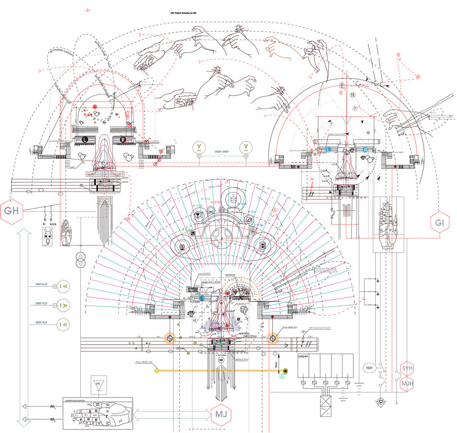

*Self-Portrait*, Minjeong An (2007)

An, M. (2007). *Self-portrait* [Impresión digital]. [myartda.com](https://www.myartda.com/current/c_01.html)

## Mapa de relaciones de Anaïs Nin en Nueva York

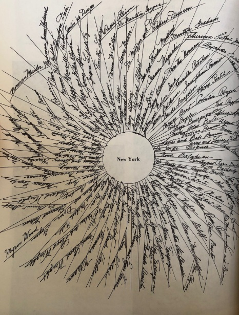

*New York*, Anaïs Nin (1974)

Snyder, R. (1976). *Anaïs Nin observed: From a film portrait of a woman as artist*. Swallow Press.

## Der Strom der Zeiten

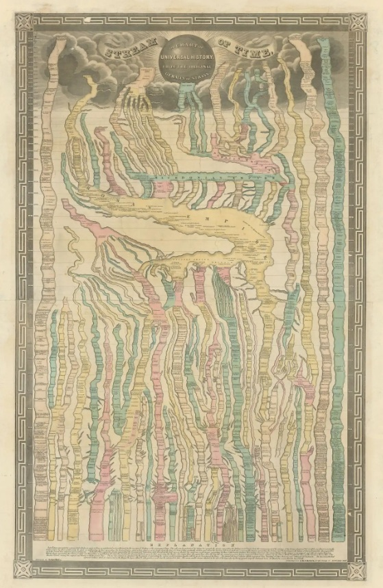

*Der Strom der Zeiten*, Friedrich Strass (1803)

C. Smith & Son. (1849). *Stream of time or chart of universal history from the German of Strass* [Carta cronológica]. C. Smith. David Rumsey Historical Map Collection. [davidrumsey.com](https://www.davidrumsey.com/luna/servlet/detail/RUMSEY~8~1~317017~90085925:Stream-of-time-or-chart-of-universa)

## Artist Statement

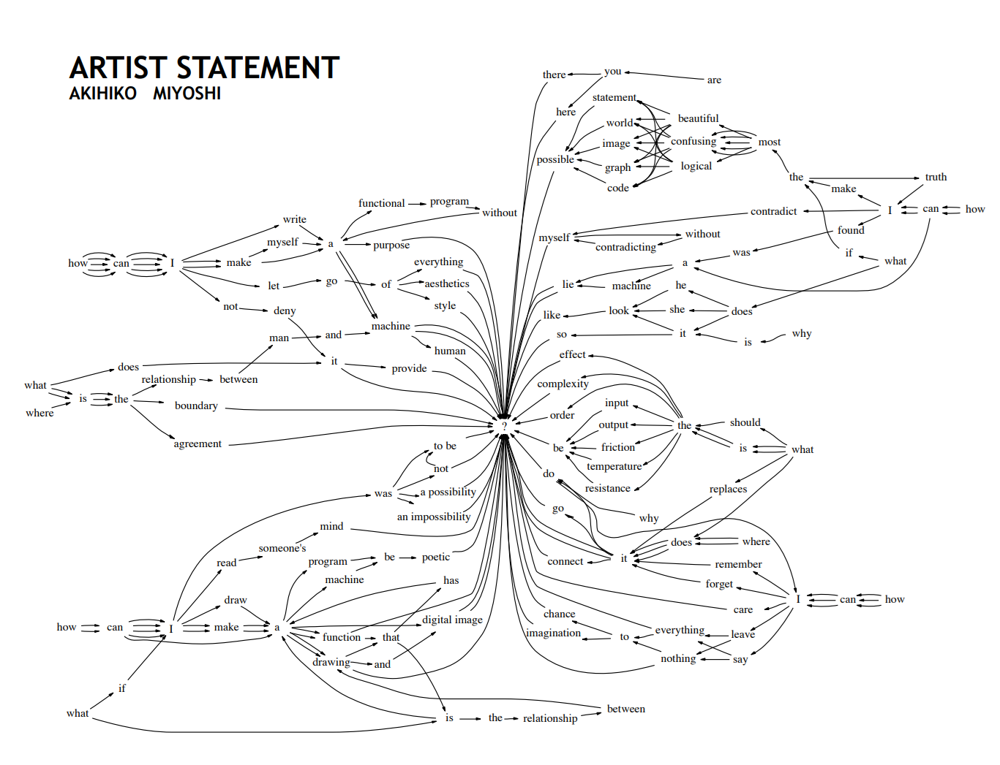

*Artist Statement*, Akihiko Miyoshi (2004)

Miyoshi, A. (2004). *Artist statement* [Diagrama]. Reed College. [people.reed.edu](https://people.reed.edu/~miyos/artist_statement.pdf)

## Mapa contra la moneda colonial

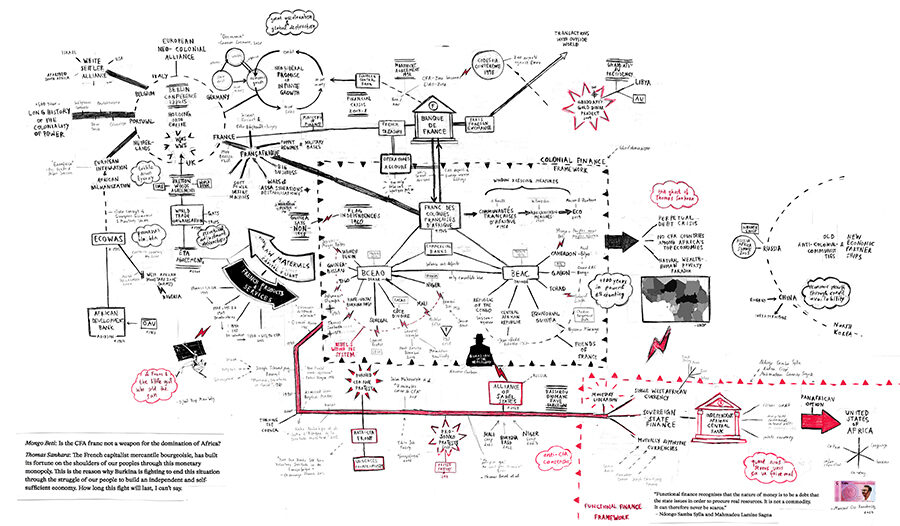

*Map Against Colonial Currency*, Moses März (2026)

März, M. (2026). *Map against colonial currency* [Mapa-diagrama]. Research Catalogue. [researchcatalogue.net](https://www.researchcatalogue.net/view/3861725/4815661)

## Mapa contra la amnesia colonial

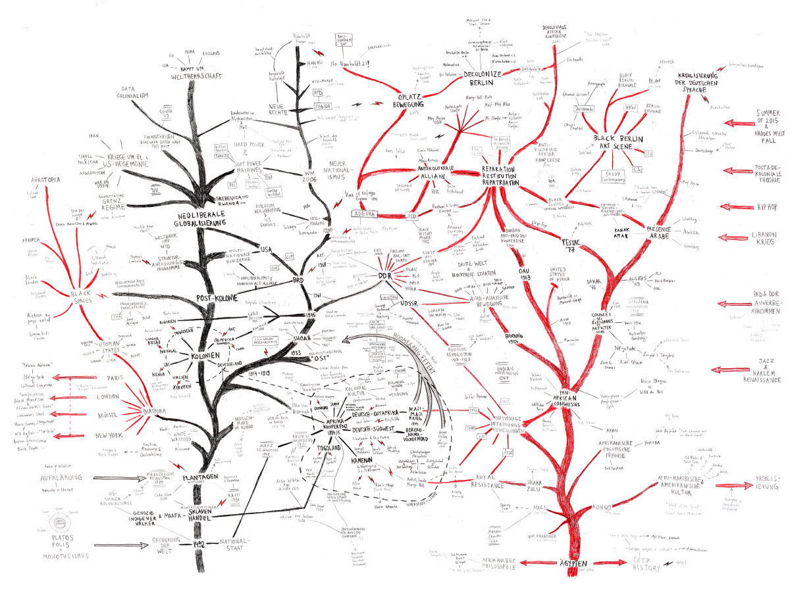

*Map Against Colonial Amnesia I*, Moses März (2023)

März, M. (2024, 13 de junio). Maps against colonial amnesia. *The Funambulist*. [thefunambulist.net](https://thefunambulist.net/magazine/colonial-continuums/map-against-colonial-amnesia-i)

## El cenote

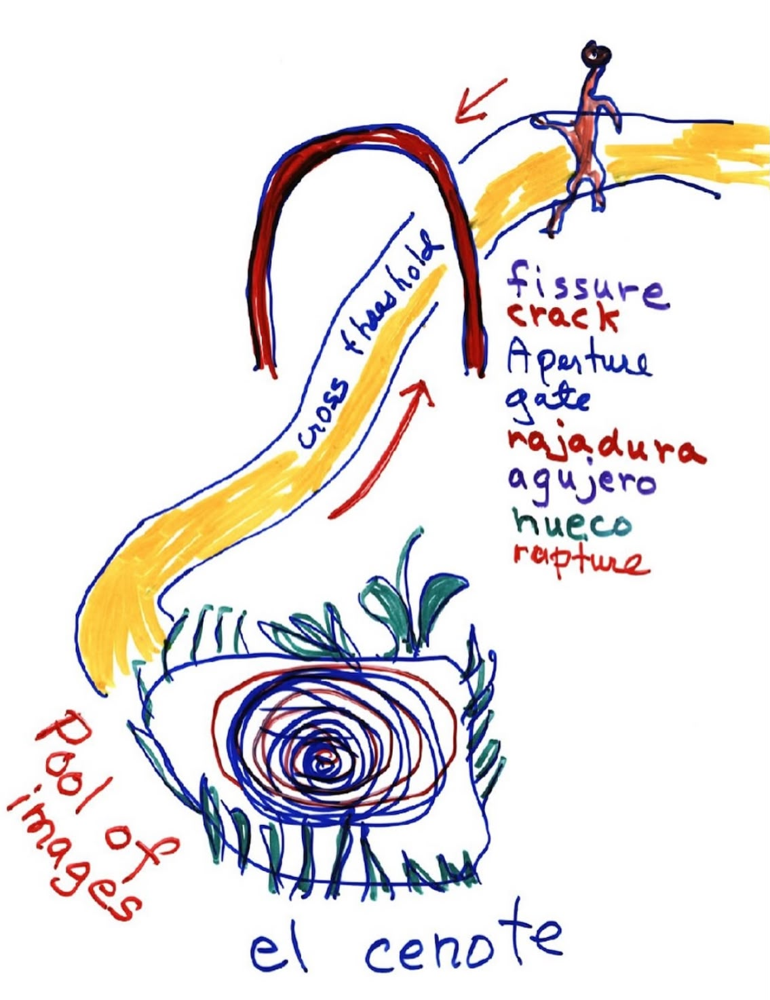

*El cenote*, Gloria E. Anzaldúa (s. f.; reproducido en publicaciones póstumas)

Anzaldúa, G. E. (2015). *Light in the dark/Luz en lo oscuro: Rewriting identity, spirituality, reality* (A. Keating, Ed.). Duke University Press. [dukeupress.edu](https://www.dukeupress.edu/light-in-the-dark-luz-en-lo-oscuro)

## Arremángala, arrempújala — Los Karkik's

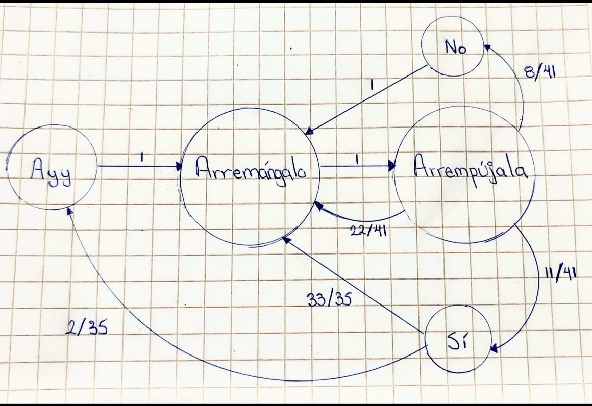

*Diagrama de la canción Arremángala, Arrempújala*, @detektivee (2026)

@detektivee. (2026, 10 de octubre). [Fotografía]. Instagram. [instagram.com/p/Dfh7k11xuut](https://www.instagram.com/p/Dfh7k11xuut/)

## Mal humor

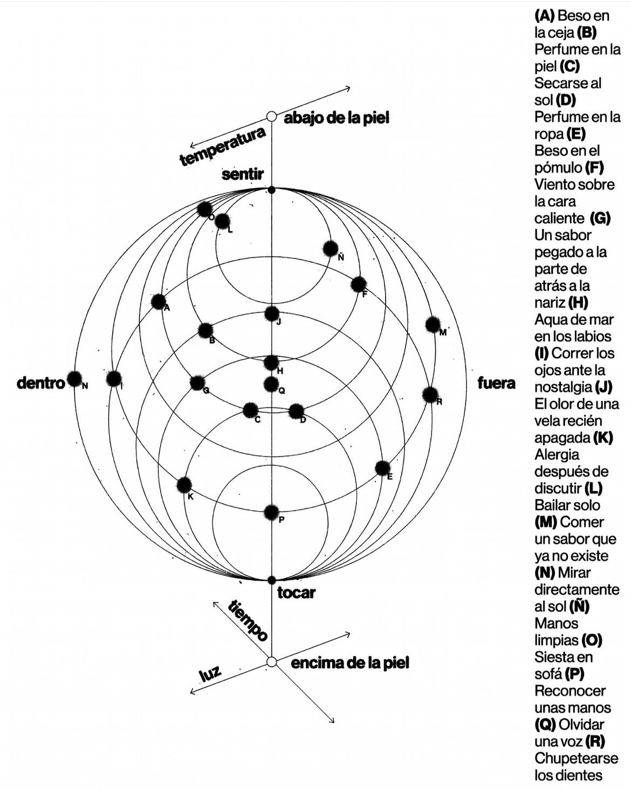

*Sin nombre*, @malhumor_st (2026)

@malhumor_st. (2026, 21 de octubre). [Ilustración]. Instagram. [instagram.com/p/DewzsrVpjrk](https://www.instagram.com/p/DewzsrVpjrk/)

## Coincidence Poetry Cube

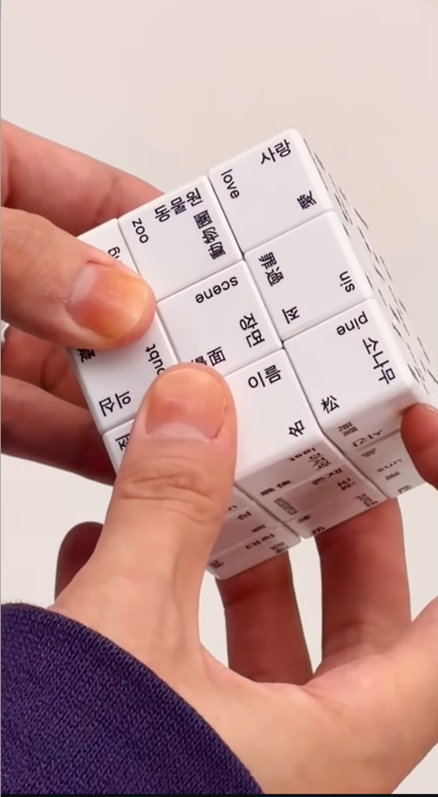

*Coincidence Poetry Cube*, DDBBMM (s. f.)

DDBBMM, Corea.

## Desire / Fate

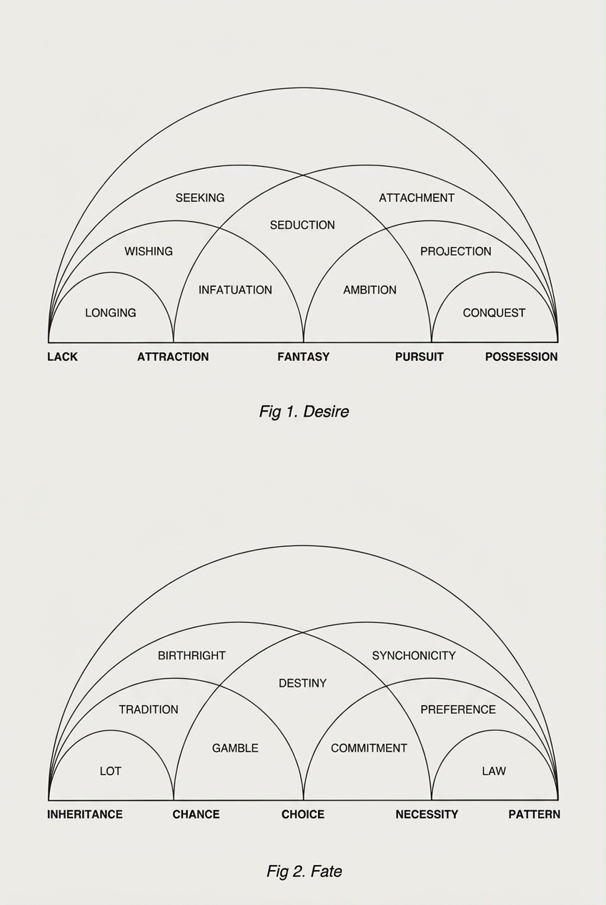

*Desire / Fate*, Rina Nicolae (2026)

@chthonic_youth. (2026, 14 de septiembre). [Diagramas *Fig 1. Desire* y *Fig 2. Fate*] [Ilustración]. Instagram. [instagram.com/p/DdRpmftjKe_](https://www.instagram.com/p/DdRpmftjKe_/?img_index=1)

## Decálogo del artista (centálogo)

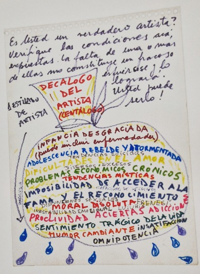

*Decálogo del artista (centálogo)*, Liliana Maresca (1994)

Maresca, L. (1994). *Decálogo del artista (centálogo)* [Dibujo]. Archivo Liliana Maresca, Buenos Aires, Argentina. [galeriavasari.com.ar](https://galeriavasari.com.ar/muestra_obra/liliana-maresca-floreceran-pajaros/decalogo-del-artista-centalogo/1381)

## Diagram of a Night’s Sleep

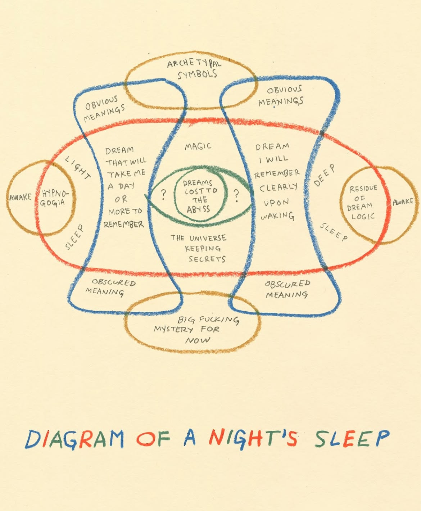

*Diagram of a Night’s Sleep*, Katie Benn (2026)

Benn, K. (2026). *Diagram of a Night’s Sleep* [Dibujo]. Instagram. [instagram.com/p/DdP8NRYpETa](https://www.instagram.com/p/DdP8NRYpETa/)
