## 01 — Body / Environment

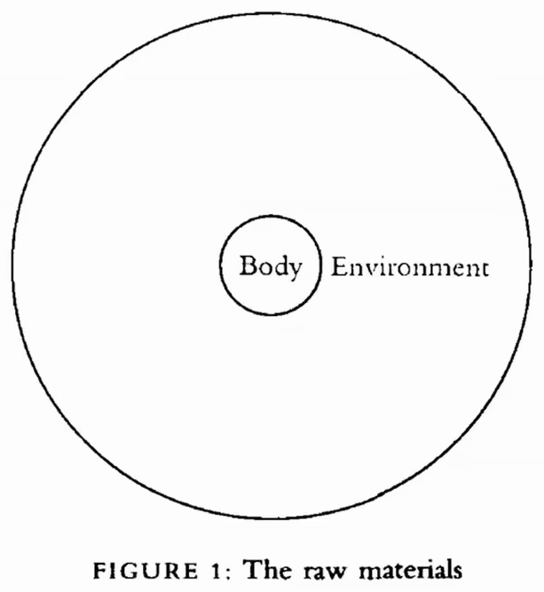

*Body / Environment* ("Figure 1: The raw materials"), autor desconocido (s. f.)

Bloque de Are.na: [are.na/block/7694147](https://www.are.na/block/7694147).

## 02 — Mapa de percepción de riesgos

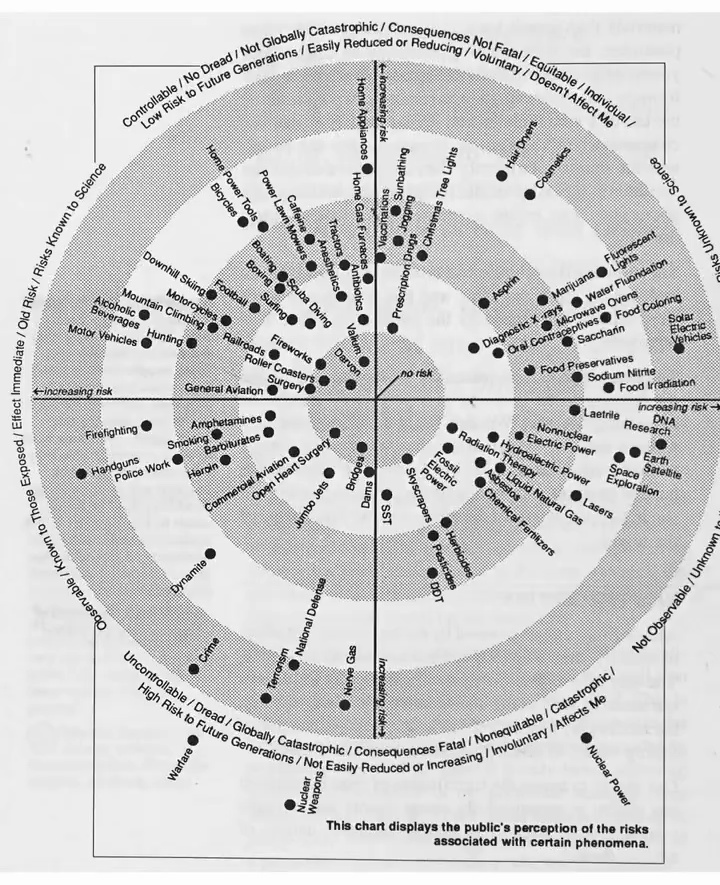

*Information Anxiety*, Richard Saul Wurman (1989)

Nueva York: Doubleday.

## 03 — Mandala del teatro orientado al contexto

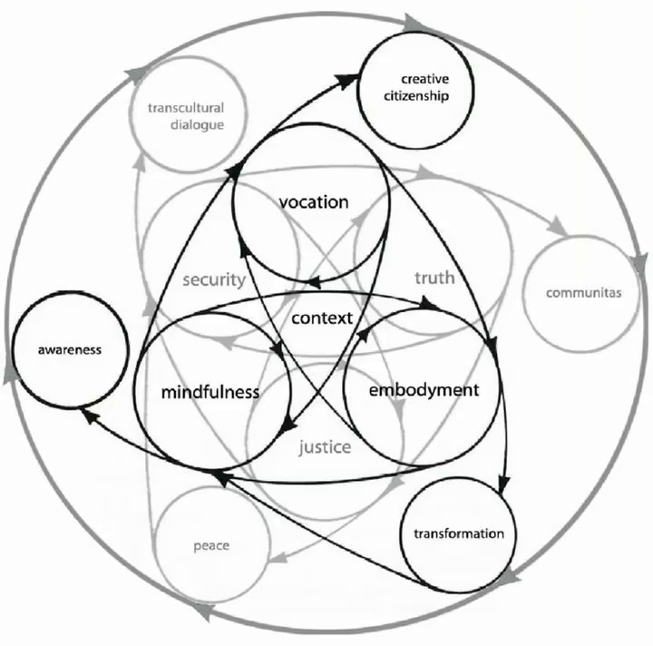

*Mandala of context oriented theatre*, autor desconocido (s. f.)

Bloque de Are.na: [are.na/block/3052676](https://www.are.na/block/3052676).

## 04 — Laberinto de la catedral de Lucca

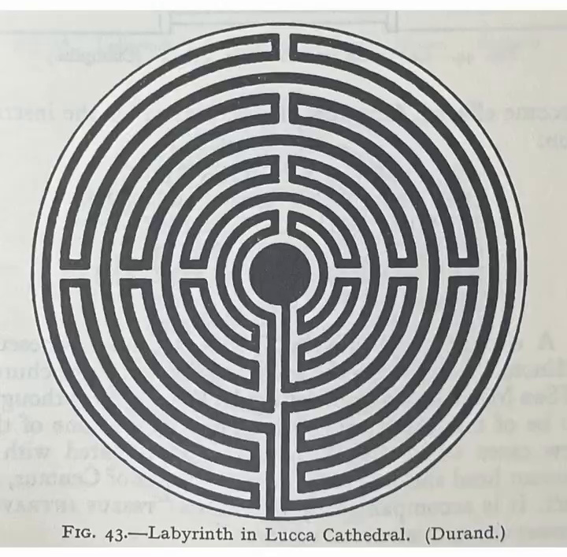

*Mazes and Labyrinths: A General Account of Their History and Developments*, W. H. Matthews (1922)

Londres: Longmans, Green and Co. Fig. 43, "Labyrinth in Lucca Cathedral (Durand)".

## 05 — Actividades de computación digital y cibernética

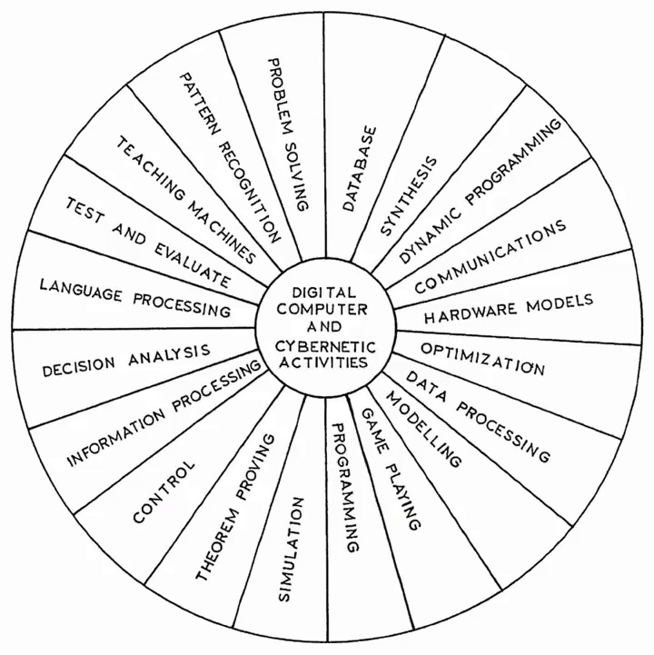

*Digital Computer and Cybernetic Activities*, autor desconocido (s. f.)

Bloque de Are.na: [are.na/block/1965168](https://www.are.na/block/1965168).

## 06 — Rueda de códigos inversos

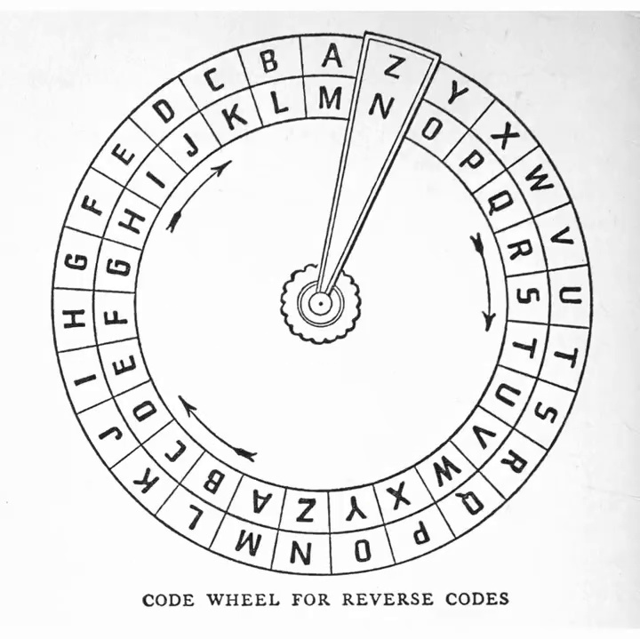

*Codes and Secret Writing*, Herbert S. Zim (1948)

Nueva York: William Morrow.

## 07 — Disposición de líneas de transmisión de un CDAA

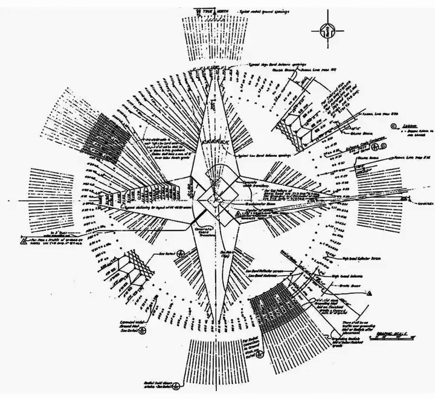

*CDAA Transmission Line Layout*, autor desconocido (s. f.)

Bloque de Are.na: [are.na/block/6920431](https://www.are.na/block/6920431).

## 08 — Figura 7: Purposing

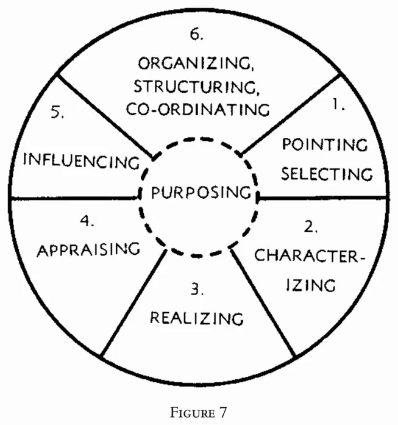

*Cybernetics / Kybernetik: The Macy-Conferences 1946–1953*, Claus Pias (ed.) (2003–2004)

Zúrich y Berlín: diaphanes. Figura 7, "Purposing".

## 09 — Rueda de la vida (reinos)

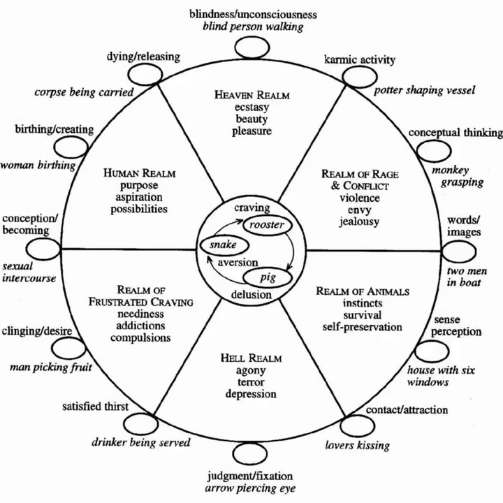

*Rueda de la vida* (bhavacakra), autor desconocido (s. f.)

Bloque de Are.na: [are.na/block/652219](https://www.are.na/block/652219).

## 10 — Gusanos y peces

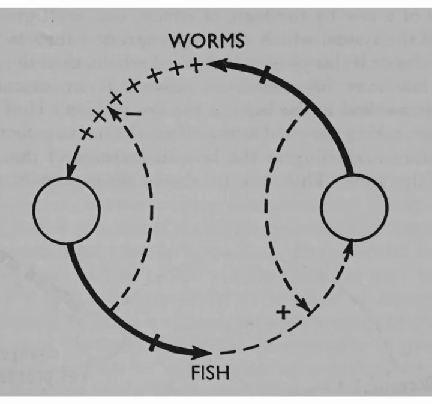

*Thinking by Machine: A Study of Cybernetics*, Pierre de Latil (1956)

Boston: Houghton Mifflin. Original en francés: *La pensée artificielle* (1953), París: Gallimard.

## 11 — Inanición en un anillo full-duplex

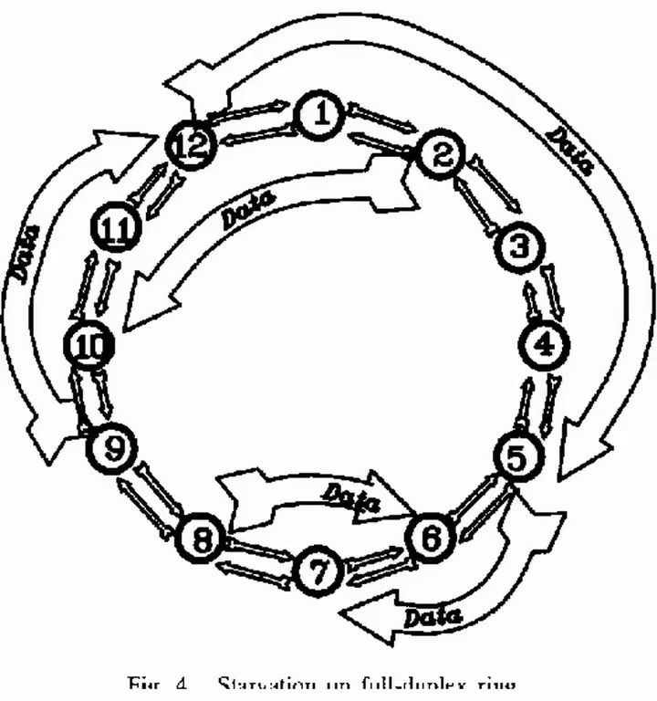

*Starvation on full-duplex ring* (Fig. 4), autor desconocido (s. f.)

Bloque de Are.na: [are.na/block/5120612](https://www.are.na/block/5120612).

## 12 — Círculos de generative somatics

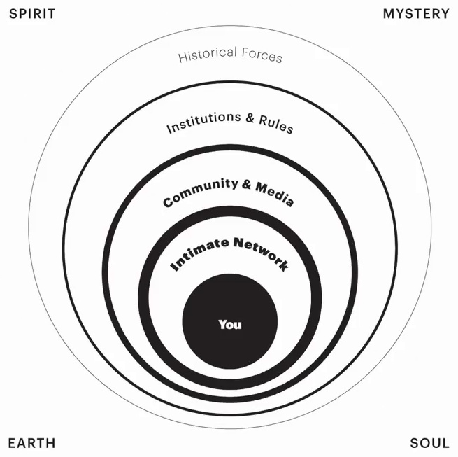

*generative somatics*, Alta Starr (s. f.)

Bloque de Are.na: [are.na/block/7381174](https://www.are.na/block/7381174).

## 13 — Teitelbaum: biofeedback dream

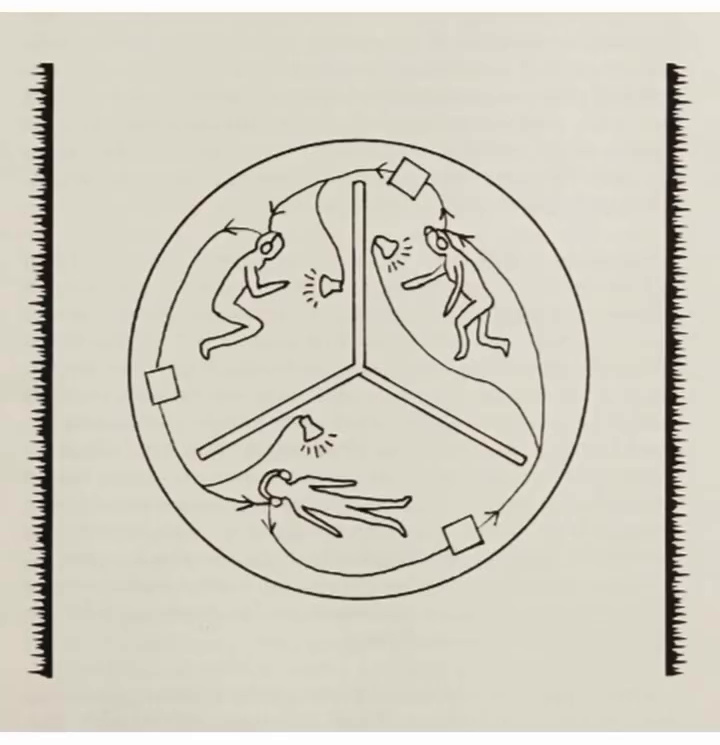

*Biofeedback dream*, Richard Teitelbaum (s. f.)

Bloque de Are.na: [are.na/block/36738359](https://www.are.na/block/36738359).

## 14 — Feedback, de Skip Sweeney

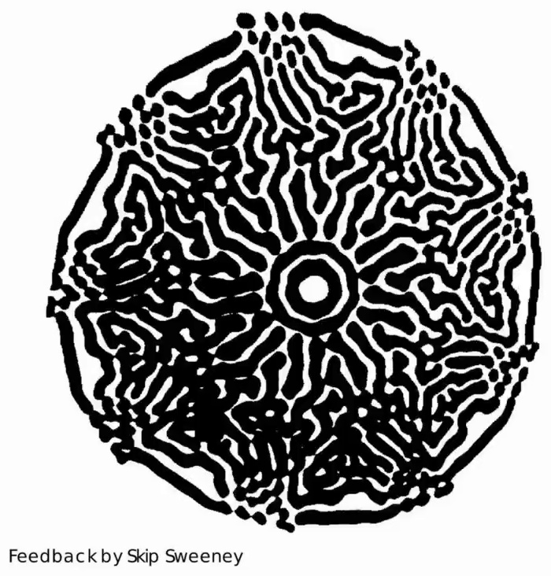

*Eigenwelt der Apparate-Welt: Pioneers of Electronic Art*, David Dunn (ed.) (1992)

Linz: Ars Electronica. Exposición curada por Woody y Steina Vasulka. Imagen: "Feedback", Skip Sweeney.

## 15 — La teoría de la información y otros campos

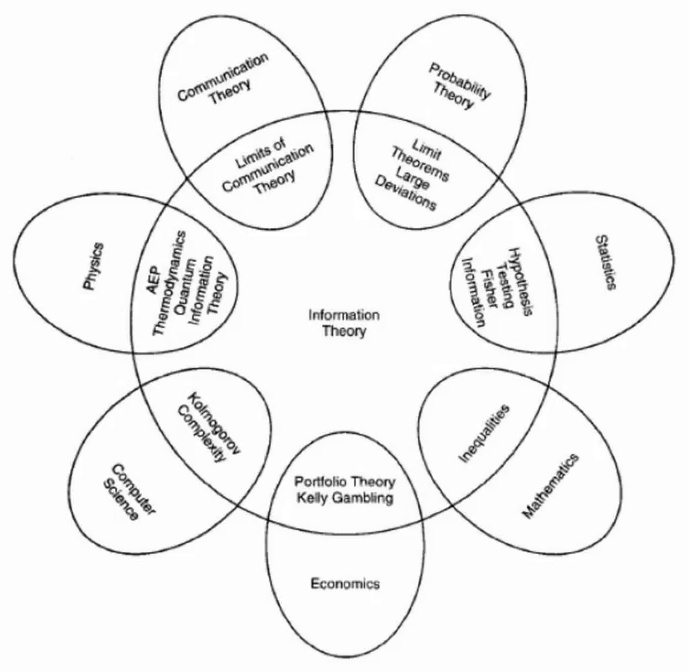

*Elements of Information Theory*, Thomas M. Cover y Joy A. Thomas (1991)

Nueva York: Wiley. Bloque de Are.na: [are.na/block/3209681](https://www.are.na/block/3209681).

## 16 — Ecuante ptolemaico

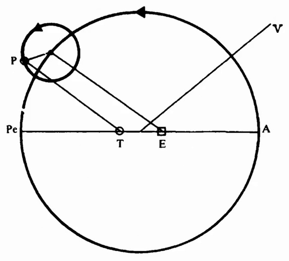

*Against Method*, Paul Feyerabend (1975)

Londres: New Left Books.
