## 01 — Body / Environment

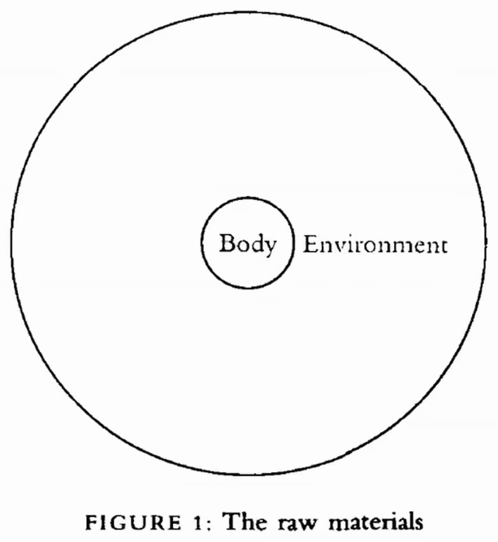

Un círculo grande con un círculo pequeño dentro: "Body" adentro, "Environment" alrededor. Lleva el pie de figura "FIGURE 1: The raw materials". Es el esquema mínimo de la relación entre sistema y entorno, donde el cuerpo aparece como un límite dentro de un medio. Fuente: bloque de Are.na `72c21004-6a7b-415a-a6eb-0b6045137330.jpg` (are.na/block/7694147). Archivo: `imagenes/01-body-environment.jpg`.

## 02 — Mapa de percepción de riesgos

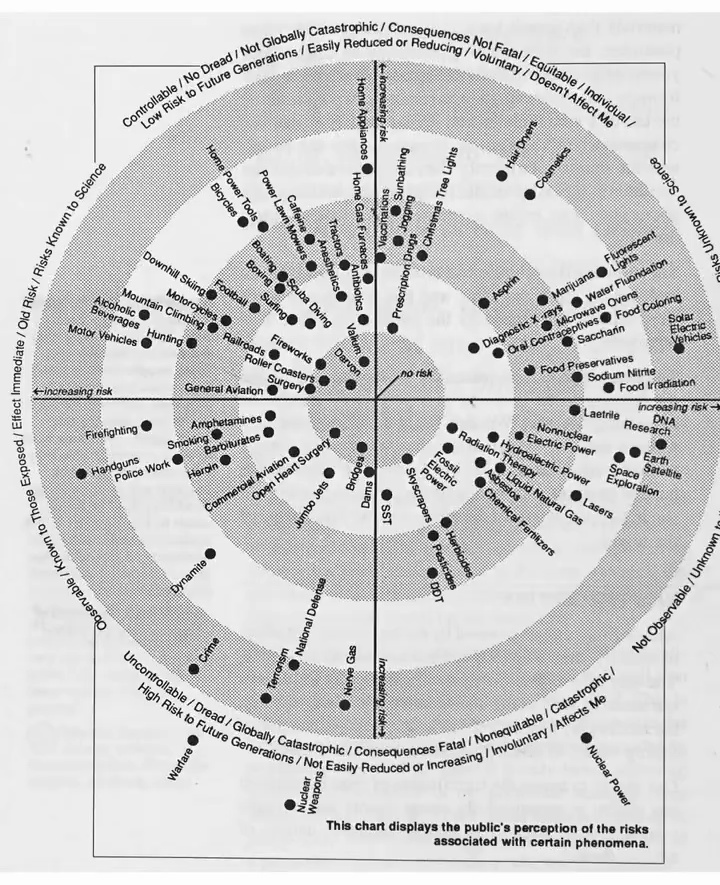

Un gráfico circular con anillos concéntricos grises y dos ejes. Uno va de riesgo controlable a incontrolable o temido, y el otro de riesgo conocido a desconocido. En los cuadrantes se ubican decenas de riesgos: armas nucleares, aviación, pesticidas, rayos X, entre otros. La leyenda indica que muestra la percepción pública de los riesgos asociados a distintos fenómenos. Fuente: *Information Anxiety*, Richard Saul Wurman. Archivo: `imagenes/02-information-anxiety-mapa-de-riesgos.jpg`.

## 03 — Mandala del teatro orientado al contexto

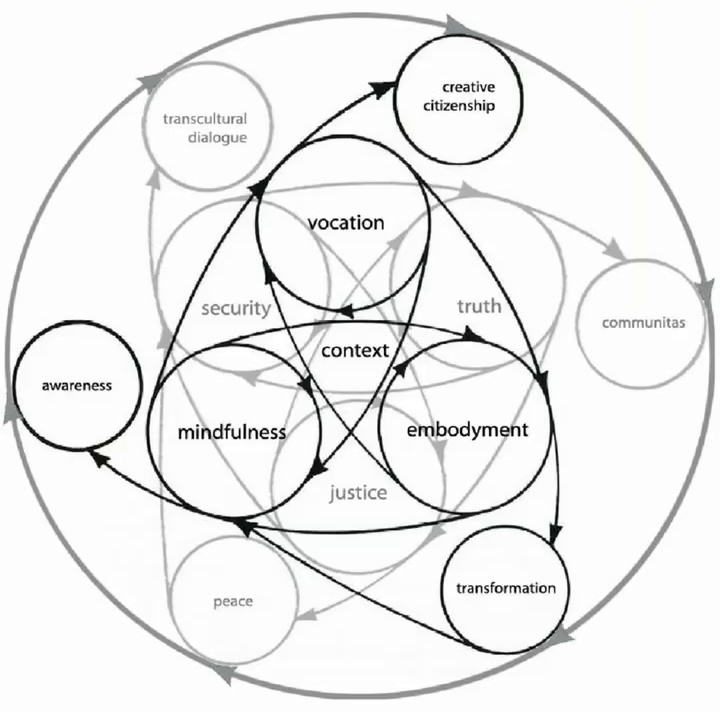

Un diagrama de círculos entrelazados con flechas. En el centro están "context", "vocation", "mindfulness" y "embodiment", con "security", "truth" y "justice" entre ellos. En la periferia aparecen "awareness", "transformation", "creative citizenship", "communitas", "transcultural dialogue" y "peace". Propone un ciclo entre práctica interior y acción social. Fuente: bloque de Are.na "mandala of context oriented theatre" (are.na/block/3052676). Archivo: `imagenes/03-mandala-teatro-orientado-al-contexto.jpg`.

## 04 — Laberinto de la catedral de Lucca

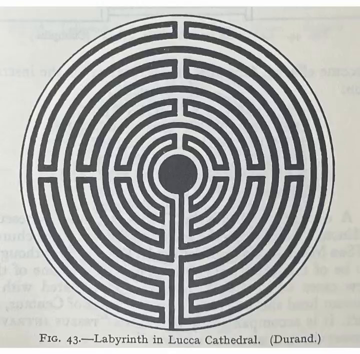

Un laberinto circular de un solo camino (unicursal) que lleva al centro. El pie de figura dice "Fig. 43.—Labyrinth in Lucca Cathedral. (Durand.)". Es el laberinto medieval grabado en el pórtico de la catedral de San Martín en Lucca, Italia. Fuente: *Mazes and Labyrinths: Their History and Development*, W. H. Matthews. Archivo: `imagenes/04-laberinto-catedral-de-lucca.jpg`.

## 05 — Actividades de computación digital y cibernética

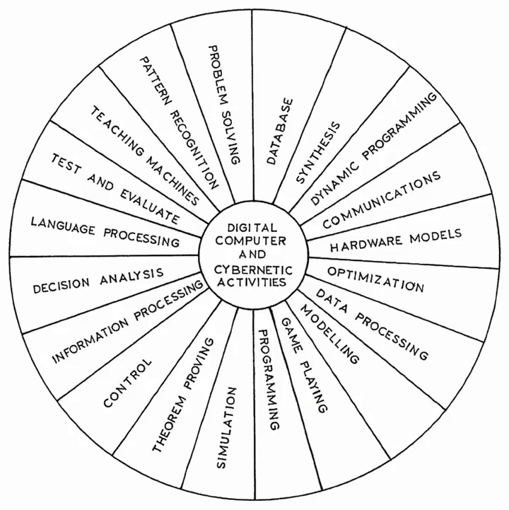

Una rueda dividida en unos veinte sectores alrededor del centro "Digital Computer and Cybernetic Activities". Los sectores incluyen pattern recognition, problem solving, theorem proving, simulation, game playing, language processing, teaching machines y optimization. Funciona como mapa de los campos que la cibernética y la computación temprana consideraban suyos. Fuente: bloque de Are.na `724.png` (are.na/block/1965168). Archivo: `imagenes/05-actividades-computacion-cibernetica.jpg`.

## 06 — Rueda de códigos inversos

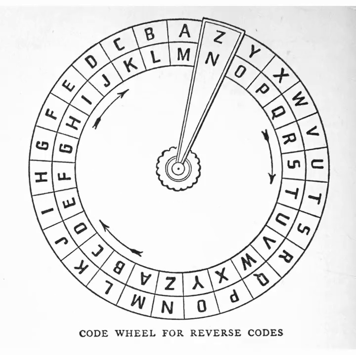

Un disco cifrador con dos anillos de letras y una aguja que alinea el alfabeto exterior con el interior, invertido. El pie dice "Code wheel for reverse codes". Es un dispositivo de sustitución simple pensado para construirse en casa. Fuente: *Codes and Secret Writing*, Herbert S. Zim. Archivo: `imagenes/06-rueda-de-codigos-inversos.jpg`.

## 07 — Disposición de líneas de transmisión de un CDAA

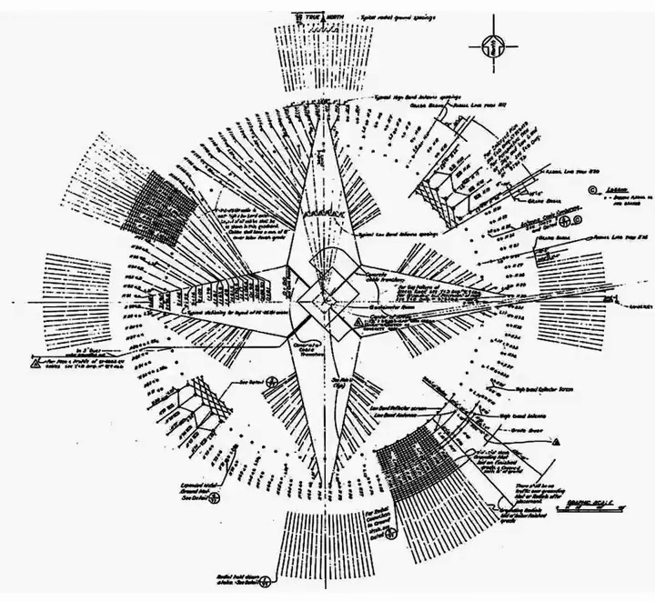

Un plano técnico radial muy denso, con una rosa de los vientos y cientos de líneas que salen de un centro. Corresponde al esquema de cableado de un CDAA (*circularly disposed antenna array*), las grandes antenas circulares de radiogoniometría conocidas como "elephant cages". Fuente: bloque de Are.na `cdaa-transmission-line-layout.jpg` (are.na/block/6920431). Archivo: `imagenes/07-cdaa-linea-de-transmision.jpg`.

## 08 — Figura 7: Purposing

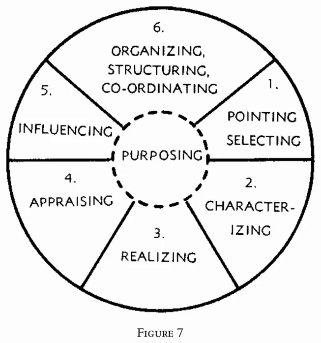

Una rueda de seis sectores numerados alrededor de un núcleo punteado, "Purposing". Los sectores son pointing/selecting, characterizing, realizing, appraising, influencing y organizing/structuring/co-ordinating. Describe las fases de una actividad orientada a fines como un ciclo. Fuente: *Cybernetics: The Macy Conferences 1946–1953*, ed. Claus Pias. Archivo: `imagenes/08-macy-conferences-figura-7.jpg`.

## 09 — Rueda de la vida (reinos)

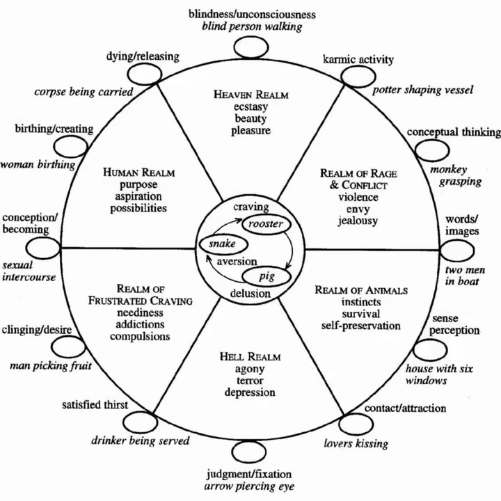

Una versión esquemática del *bhavacakra* budista. En el centro están los tres venenos (gallo, serpiente y cerdo: deseo, aversión e ignorancia). Alrededor se ubican los seis reinos (celestial, humano, de la ira, animal, de los espíritus hambrientos e infernal), cada uno con sus estados. En el borde aparecen los doce eslabones del origen dependiente con sus imágenes tradicionales. Fuente: bloque de Are.na `large_a13665e3a5633d8ea974c7064aeedc45.jpg` (are.na/block/652219). Archivo: `imagenes/09-rueda-de-la-vida.jpg`.

## 10 — Gusanos y peces

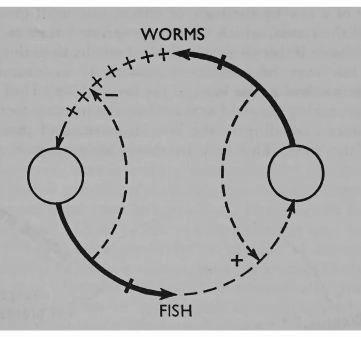

Un diagrama sobre fondo gris con dos círculos unidos por trayectorias, una continua y otra punteada, marcadas con signos + y ×, entre "Worms" (arriba) y "Fish" (abajo). Ilustra un ciclo de retroalimentación entre dos poblaciones, presa y depredador. Fuente: *Thinking by Machine: A Study of Cybernetics*, Pierre de Latil. Archivo: `imagenes/10-gusanos-y-peces-de-latil.jpg`.

## 11 — Inanición en un anillo full-duplex

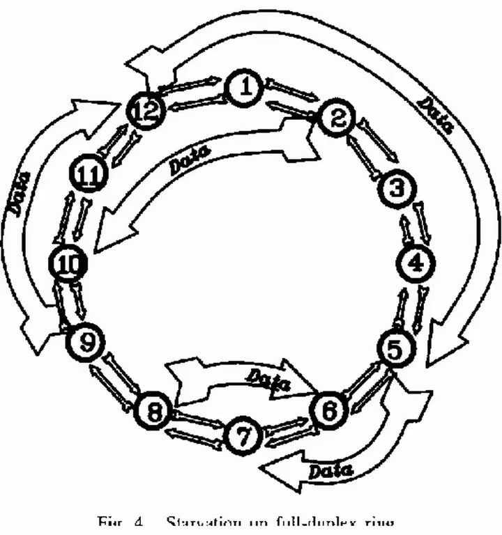

Doce nodos numerados en anillo, unidos por flechas dobles, con grandes flechas de "Data" que circulan por fuera y por dentro. El pie de figura, cortado en el video, dice "Fig. 4. Starvation on full-duplex ring". Muestra cómo, en una red en anillo, algunos nodos pueden quedar sin turno para transmitir. Fuente: bloque de Are.na `3-figure4-1.png` (are.na/block/5120612). Archivo: `imagenes/11-anillo-full-duplex.jpg`.

## 12 — Círculos de generative somatics

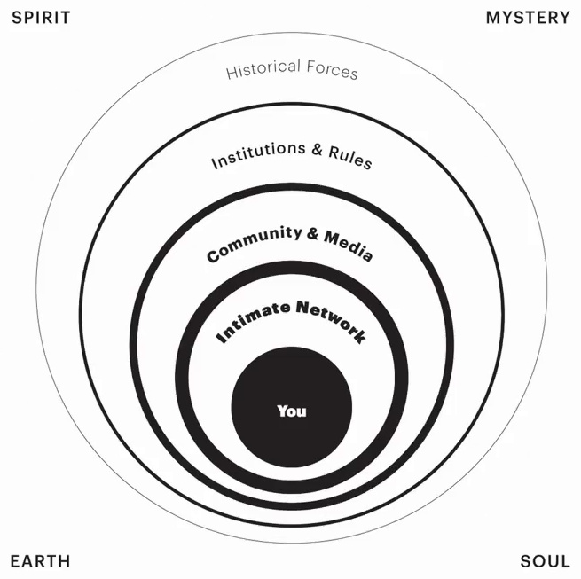

Unos círculos concéntricos que van de "You" en el centro a "Intimate Network", "Community & Media", "Institutions & Rules" y "Historical Forces". En las esquinas están Spirit, Mystery, Earth y Soul. Es un modelo de cómo la persona está anidada en sistemas sociales cada vez más amplios. Fuente: bloque de Are.na "generative somatics alta starr" (are.na/block/7381174). Archivo: `imagenes/12-generative-somatics-circulos.jpg`.

## 13 — Teitelbaum: biofeedback dream

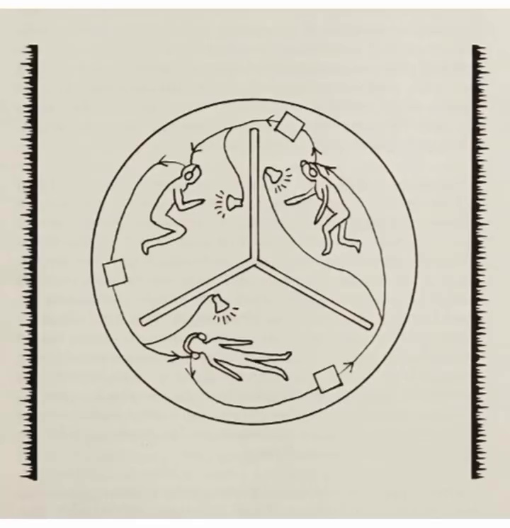

Un dibujo lineal dentro de un círculo dividido en tres, con figuras humanas que caen, se mueven y yacen, unidas por flechas y pequeños cuadrados. Está enmarcado por dos reglas verticales. Se asocia al trabajo de Richard Teitelbaum con biofeedback y música en vivo. Fuente: bloque de Are.na "Teitelbaum - biofeedback-dream" (are.na/block/36738359). Archivo: `imagenes/13-teitelbaum-biofeedback-dream.jpg`.

## 14 — Feedback, de Skip Sweeney

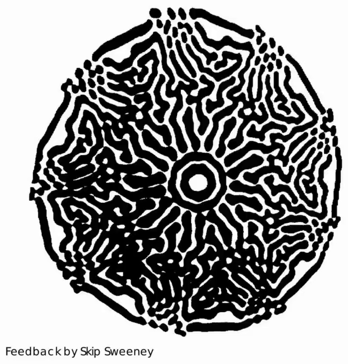

Una mancha circular de formas negras orgánicas, como un patrón de Turing o de reacción-difusión, alrededor de un centro concéntrico. Lleva el crédito "Feedback by Skip Sweeney". Es una imagen de retroalimentación de video, cámara apuntando a su propio monitor, del pionero del videoarte de San Francisco. Fuente: *Eigenwelt der Apparate-Welt: Pioneers of Electronic Art*. Archivo: `imagenes/14-feedback-skip-sweeney.jpg`.

## 15 — La teoría de la información y otros campos

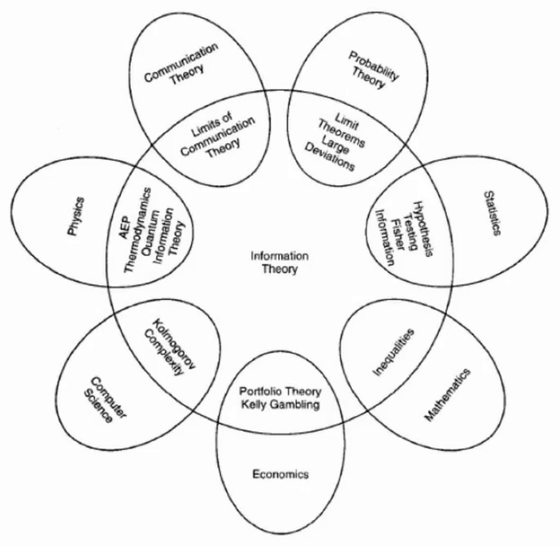

Un diagrama de pétalos con "Information Theory" en el centro, rodeado de campos con los que se solapa: física, teoría de la comunicación, probabilidad, estadística, matemáticas, economía, ciencias de la computación. En cada intersección hay un concepto compartido, como complejidad de Kolmogorov, test de hipótesis o portfolio theory. Es la figura de apertura de *Elements of Information Theory* de Cover y Thomas. Fuente: bloque de Are.na `6c9731dc-b01f-4301-aff8-b47aa217f6c1.jpg` (are.na/block/3209681). Archivo: `imagenes/15-teoria-de-la-informacion.jpg`.

## 16 — Ecuante ptolemaico

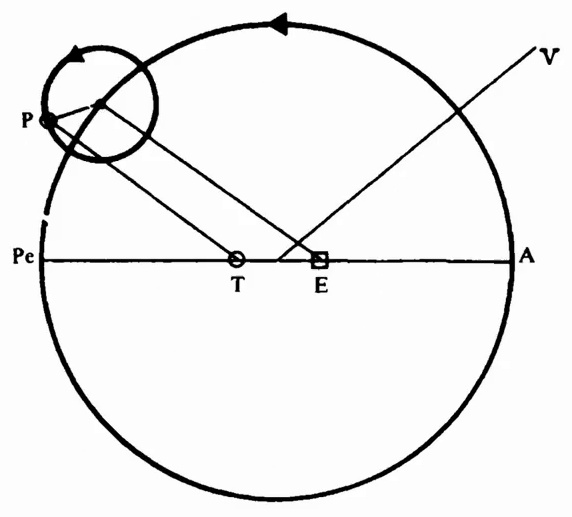

Un círculo deferente con un epiciclo en el punto P. Sobre el diámetro están la Tierra (T), el punto ecuante (E), el apogeo (A) y el perigeo (Pe), y una línea de visión hacia V. Es el modelo de Ptolomeo para el movimiento de los planetas, que Feyerabend usa al discutir la astronomía antes de Copérnico. Fuente: *Against Method*, Paul Feyerabend. Archivo: `imagenes/16-ecuante-ptolemaico.jpg`.
